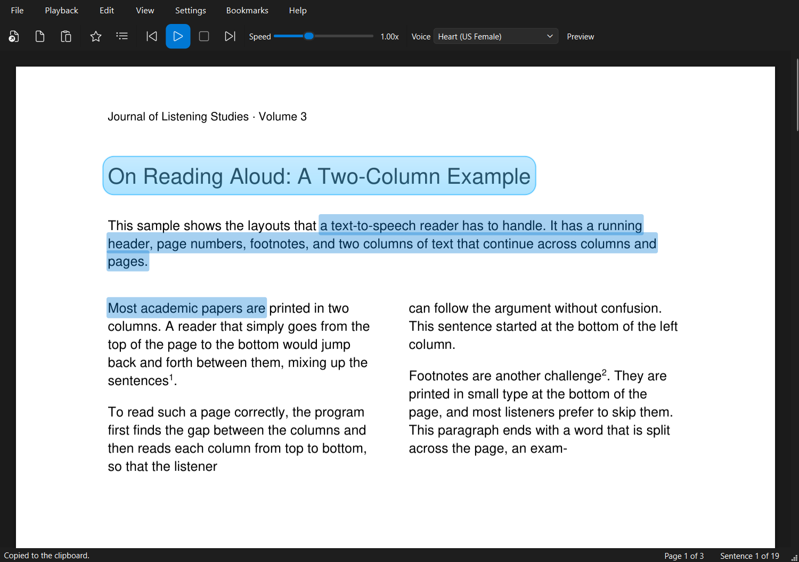

# PDF Reader

**Listen to your PDFs, e-books, Word documents, web pages, and any text with
natural-sounding AI voices, offline and private.**

PDF Reader is a free, open-source Windows desktop app that reads documents aloud: PDFs
(including scans), EPUB e-books, Word files, web pages, or any text you paste into it.
It uses the [Kokoro](https://huggingface.co/hexgrad/Kokoro-82M) neural text-to-speech
model, which runs entirely on your own computer: no cloud, no account, no API keys, and
your documents never leave your PC. Think of it as a private alternative to Speechify.

> **Status:** early development (v0.9). See the [roadmap](ROADMAP.md) for what's next.



## Features

- **Natural AI voices.** 28 English voices (American and British, female and male),
  with friendly names such as "Heart (US Female)" and a **Preview** button.
- **Word-by-word highlighting.** The word being spoken glides along the highlighted
  sentence, on page images and in the text view, timed by the voice model itself.
- **Runs offline.** After a one-time download of the voice model (about 354 MB), the
  app only uses the internet when you open a web link.
- **Many formats.** PDF, EPUB (and MOBI, FB2, XPS, CBZ), Word (.docx), saved web
  pages, Markdown, and text files. Paste or type a web address (Ctrl+L) to listen to
  an article without the menus and ads, or to open an online PDF.
- **Listening time.** The player shows time listened, time left, and how far you are
  ("23% · 12 min left"), at the current speed.
- **Reading comfort.** Light, sepia, and dark themes (View > Theme; sepia also warms
  the pages), and a dyslexia-friendly font, OpenDyslexic (View > Dyslexia-Friendly
  Font, in the text view).
- **Export to MP3.** Save a whole document as an MP3 (or WAV) to listen on your phone
  (File > Export Audio, Ctrl+Shift+S), with the document's title in the file.
- **Media keys.** Play/pause and next/previous keys on keyboards and headsets work,
  and the Windows media panel shows what's being read, with its cover.
- **Smart text cleanup.** Page numbers, running headers and footers, and footnotes are
  skipped; two-column pages are read column by column; and sentences that continue
  across a column or page break are read as one sentence.
- **A home for your reading.** Recent documents appear as covers with your progress,
  next to one-click "Open a PDF" and a box to paste or type any text.
- **Natural, flowing speech.** Sentences join seamlessly at an even volume, with
  natural pauses between sentences and paragraphs, and shorthand like "e.g." or
  "Fig. 3" is read the way a person would say it.
- **See the real page.** PDFs open as page images: click any word to start reading
  there, hover to preview, and the spoken sentence is highlighted right on the page.
  Prefer plain text? Settings > Show PDFs as Page Images.
- **Textbook-smart.** Follows the main text and skips sidebars, margin boxes, figure
  captions, and diagram labels (Settings > Skip Sidebars, Captions & Labels).
- **Copy and zoom.** Select text and copy it (Ctrl+C), copy everything
  (Ctrl+Shift+C), and zoom with Ctrl + mouse wheel.
- **Scanned PDFs too.** Pages that are just images (from a scanner or copier) are read
  with the text recognition (OCR) built into Windows, offline. The pages are shown as
  images: click any word to start reading there, and the spoken sentence is
  highlighted on the page. Switch to the recognized text with View > Show Page Images.
- **Read any text.** Paste text from a web page, email, or anywhere else (Ctrl+V), or
  type it in a new text document (Ctrl+N), and have it read aloud.
- **Picks up where you left off.** Reopen a PDF and it continues at the sentence where
  you stopped, even if the file was moved or renamed (with a one-click "Start from the
  beginning").
- **Bookmarks.** Bookmark any sentence (Ctrl+B), name your bookmarks, and jump back to
  them from the Bookmarks panel (Ctrl+Shift+B).
- **Recent documents.** File > Open Recent brings back the PDFs you were reading.
- **Follow along.** The sentence being read is highlighted and kept in view.
- **Click to jump.** Click any sentence to start reading from there.
- **Smooth playback.** Upcoming sentences are prepared in the background, so there are
  no gaps between them.
- **Speed control.** 0.5x to 4.0x, with the voice's natural pitch kept at high
  speeds; changes apply from the next sentence without a pause.
- **Simple controls.** Play/Pause, Stop, Previous/Next sentence, and keyboard shortcuts.
- **Open documents your way.** Use File > Open, the toolbar, or drag and drop a file,
  a link, or text onto the window.
- **Remembers your preferences.** Voice, speed, window layout, and the last folder you
  opened.
- **Friendly errors.** Password-protected, damaged, and blank PDFs are explained
  clearly instead of crashing the app.

### Keyboard shortcuts

| Key | Action |
| --- | --- |
| Space | Play / Pause |
| Left arrow | Previous sentence |
| Right arrow | Next sentence |
| Ctrl+H | Home page |
| Ctrl+O | Open a document |
| Ctrl+L | Open a web link |
| Ctrl+Shift+S | Export audio (MP3) |
| Ctrl+N | New text document (type or paste text) |
| Ctrl+V | Paste text (or a link) from the clipboard and read it |
| Ctrl+E | Edit the current text document |
| Ctrl+B | Bookmark the current sentence |
| Ctrl+Shift+B | Show or hide the Bookmarks panel |
| Ctrl+Shift+P | Switch between page images and the text view |
| Ctrl+C / Ctrl+Shift+C | Copy the selection / copy all text |
| Ctrl + wheel, Ctrl+= / Ctrl+- / Ctrl+0 | Zoom in / out / actual size |

## Requirements

- Windows 10 (version 1809 or later) or Windows 11, 64-bit
- About 1 GB of free disk space (the app plus the voices)
- 4 GB of memory or more recommended (reading uses about 1 GB)
- An internet connection **once**, for the voice download (and when you open web links)

## Installation

### The easy way: the installer

1. Go to the [latest release](https://github.com/Toyboat1000/pdf-reader/releases/latest)
   and download **`PDF-Reader-Setup-<version>.exe`**.
2. Double-click it and follow the steps. It installs for your user account only, so it
   never asks for administrator rights.
3. Leave **Download the natural voices now** ticked (about 354 MB, once). Each file is
   checked against its published SHA-256 fingerprint. If you untick it, or you're
   offline, the app downloads the voices the first time it starts.
4. Open **PDF Reader** from the Start menu (or the desktop shortcut, if you chose one).

**"Windows protected your PC"?** The installer isn't code-signed yet (signing
certificates cost money), so Windows SmartScreen may warn about a new, unknown
publisher. Click **More info**, then **Run anyway**. To be sure the file is genuine,
compare its fingerprint with `SHA256SUMS.txt` from the same release:

```powershell
Get-FileHash .\PDF-Reader-Setup-<version>.exe -Algorithm SHA256
```

The two values must match exactly.

**What the installer does:** it copies the app to `%LOCALAPPDATA%\Programs\PDF Reader`,
adds a Start menu shortcut (and optionally a desktop shortcut and "Open with" entries
for PDF, EPUB, and Word files, which never replace your default apps), and registers an
uninstaller. It doesn't install services, background tasks, or anything outside your
user profile. Updating: run the newer installer; your voices, settings, positions, and
bookmarks are kept.

**Uninstalling:** Settings > Apps > Installed apps > PDF Reader > Uninstall. You'll be
asked whether to also remove the downloaded voices, settings, and reading history.

### From source (developers)

PDF Reader also runs from source with [uv](https://docs.astral.sh/uv/), which takes care
of Python and all dependencies.

1. Install uv (one time), then close and reopen PowerShell:

   ```powershell
   winget install --id astral-sh.uv -e
   ```

2. Clone [the repository](https://github.com/Toyboat1000/pdf-reader) (or download it as
   a ZIP from the green **Code** button and extract it), and in its folder run:

   ```powershell
   uv run pdf-reader
   ```

   The first start installs dependencies, which takes a minute or two. On first launch
   the app offers the one-time voice download; if it's interrupted, **Retry** resumes
   it.

## Where your data is stored

| What | Location |
| --- | --- |
| Settings | `%APPDATA%\PDF Reader\settings.json` |
| Reading positions, bookmarks, recent files | `%APPDATA%\PDF Reader\library.json` |
| Voice model | `%LOCALAPPDATA%\PDF Reader\models\` |
| Saved OCR results and covers | `%LOCALAPPDATA%\PDF Reader\ocr-cache\`, `thumbnails\` |
| Log files | `%LOCALAPPDATA%\PDF Reader\logs\` (also via **Help > Open Log Folder**) |

The uninstaller offers to remove these. When running from source, delete the project
folder and the two `PDF Reader` folders above to remove everything.

## Troubleshooting

- **No sound:** check that speakers or headphones are connected and set as the default
  output device in Windows, then press Play again.
- **The model download fails:** check your internet connection and click **Retry**. If
  you skipped the download, use **Help > Download Voice Model**.
- **"No readable text was found" for a scanned PDF:** reading scans uses Windows'
  built-in text recognition, which needs a Windows display language with OCR support
  (English is normally included). Check Settings > Time & language > Language & region.
- **Something else:** open **Help > Open Log Folder** and attach `app.log` to a GitHub
  issue.

## For developers

### Setup

```powershell
git clone https://github.com/Toyboat1000/pdf-reader.git
cd pdf-reader
uv sync              # creates .venv with Python 3.12 and all dependencies
uv run pdf-reader    # or: uv run python -m pdf_reader
```

### Tests and linting

```powershell
uv run pytest                 # unit tests (fast; no model or sound card needed)
uv run ruff check .           # lint
uv run ruff format .          # format
```

The tests use a fake TTS engine and a fake audio device, so they run in seconds on any
machine, including CI. Qt tests run off-screen. A few integration tests in
`tests/test_kokoro_integration.py` use the real voice model; they are skipped
automatically until the model has been downloaded (by running the app once).

To try the app without a PDF of your own, generate a sample:

```powershell
uv run python scripts/make_sample_pdf.py sample.pdf
uv run python scripts/make_sample_pdf.py --layout layout-sample.pdf   # columns, footnotes
```

### Building the installer

```powershell
winget install --id JRSoftware.InnoSetup -e   # once
powershell -ExecutionPolicy Bypass -File packaging\build.ps1
```

This runs the tests, builds the app with PyInstaller (`packaging/pdf-reader.spec`),
and compiles the setup wizard with Inno Setup (`packaging/installer.iss`) into
`dist\PDF-Reader-Setup-<version>.exe`, plus `dist\SHA256SUMS.txt`. The voice model's
addresses and SHA-256 hashes come from the app's code (`packaging/write_defines.py`),
so the installer and the app always agree. To code-sign, pass
`-SignTool "signtool sign /a /fd sha256 /tr <timestamp-url> /td sha256 $f"`. The icon
and wizard pictures are drawn by `packaging/make_artwork.py`.

### Project layout

```
src/pdf_reader/
  config/   app name, file locations, settings, logging
  pdf/      PDF loading and text extraction (with page/position data)
  text/     text pipeline: layout cleanup and text steps (small ordered steps)
  library/  remembered documents: reading positions, bookmarks, recent files
  tts/      TTS engine interface, Kokoro engine, model download
  audio/    gap-free player and look-ahead generation queue
  core/     reading session: document, position, state machine
  ui/       all PySide6 code
tests/      pytest suite with fakes for the engine and audio device
scripts/    developer utilities (sample PDF generators)
packaging/  installer: PyInstaller spec, Inno Setup script, build script, artwork
```

[CLAUDE.md](CLAUDE.md) documents the architecture and conventions in more detail.

### Contributing

Issues and pull requests are welcome. Please run `uv run pytest` and
`uv run ruff check .` before submitting, and keep each module within its
responsibility (see [CLAUDE.md](CLAUDE.md)).

## Credits

PDF Reader is built on these projects. Thank you to their authors and contributors.

| Project | Used for | License |
| --- | --- | --- |
| [Kokoro-82M](https://huggingface.co/hexgrad/Kokoro-82M) by hexgrad | The AI voice model | Apache-2.0 |
| [kokoro-onnx](https://github.com/thewh1teagle/kokoro-onnx) by thewh1teagle | Running Kokoro with ONNX Runtime; model file hosting | MIT |
| [PyMuPDF](https://github.com/pymupdf/PyMuPDF) by Artifex | PDF text extraction | AGPL-3.0 (or commercial) |
| [PySide6 / Qt for Python](https://doc.qt.io/qtforpython-6/) | User interface | LGPL-3.0 |
| [ONNX Runtime](https://github.com/microsoft/onnxruntime) by Microsoft | Neural network inference | MIT |
| [eSpeak NG](https://github.com/espeak-ng/espeak-ng) (via espeakng-loader) and [phonemizer](https://github.com/bootphon/phonemizer) | Converting text to phonemes | GPL-3.0-or-later |
| [python-sounddevice](https://github.com/spatialaudio/python-sounddevice) and PortAudio | Audio output | MIT |
| [NumPy](https://numpy.org/) | Audio buffers | BSD-3-Clause |

## License

Copyright (C) 2026 Luke Oberlin.

PDF Reader is free software, licensed under the
[GNU Affero General Public License v3.0 or later](LICENSE). This license is required
because the app uses PyMuPDF, which is AGPL-licensed.
